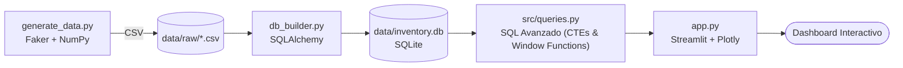
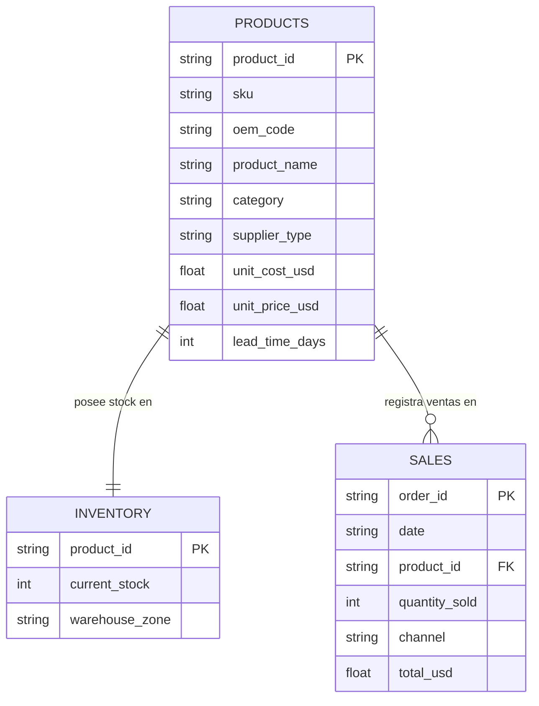

# 🔧 Autoparts Inventory Analytics

*Proyecto integral de Data Engineering & Business Intelligence enfocado en la optimización de la cadena de suministro, automatización de pipelines ETL y analítica avanzada de inventario para un distribuidor de repuestos automotrices.*

---

## 📊 Resumen Ejecutivo

Este proyecto resuelve problemáticas críticas del sector retail y logístico —como quiebres de stock, sobrestock e inmovilización de capital— utilizando un stack tecnológico moderno, robusto y 100% local (**Python, SQLite, Streamlit y Plotly**). 

Diseñado específicamente como una **pieza central de portfolio para posiciones de Data Analyst y BI**, demuestra competencias de extremo a extremo:
1. **Data Engineering:** Generación automatizada de datos sintéticos (`Faker`, `NumPy`) y modelado de bases de datos relacionales mediante SQLAlchemy.
2. **SQL Avanzado:** Uso intensivo de CTEs, tablas de calendario recursivas y funciones de ventana (`WINDOW FUNCTIONS`) para resolver lógica de negocio compleja sin sobrecargar la memoria de la aplicación.
3. **Lógica de Negocio Logística:** Implementación automatizada de métricas de supply chain como Punto de Reorden (ROP), Stock de Seguridad dinámico ($Z=1.65$), Días de Suministro (DOS), Clasificación ABC (Pareto) y detección de *Dead Stock*.
4. **Visualización y BI:** Un dashboard interactivo de alto rendimiento que integra filtros relacionales en tiempo real y capacidades de exportación ejecutiva (CSV/Excel).

---

## ⚙️ Arquitectura y Pipeline de Datos



1. **`generate_data.py`**: Simula transacciones de un distribuidor, creando un catálogo de 150 repuestos, inventario por zonas de almacén y 5.000 registros de ventas históricos de los últimos 180 días.
2. **`db_builder.py`**: Carga los datos crudos hacia una base relacional SQLite (`data/inventory.db`) a través de SQLAlchemy, optimizando índices para consultas analíticas rápidas.
3. **`src/queries.py`**: La capa analítica central. Cada indicador de negocio se procesa mediante consultas SQL seguras (con parámetros para prevenir inyección SQL) que retornan DataFrames listos para consumir.
4. **`app.py`**: Interfaz de usuario interactiva en Streamlit que conecta los filtros de la barra lateral con la capa de consultas, actualizando dinámicamente el análisis visual.

---

## 🗂️ Estructura del Repositorio

```
autoparts-inventory-analytics/
├── app.py                  # Aplicación principal del Dashboard (Streamlit)
├── generate_data.py        # Generador de datos sintéticos realistas
├── db_builder.py           # ETL de carga: CSVs a SQLite relacional
├── requirements.txt        # Dependencias del proyecto
├── .gitignore              # Archivos excluidos (entornos virtuales y binarios)
├── README.md               # Documentación oficial
├── src/
│   ├── __init__.py
│   └── queries.py          # Capa de consultas SQL avanzadas
└── data/
    ├── raw/                # Archivos CSV fuente generados
    └── inventory.db          # Base de datos SQLite persistente
```

---

## 🧬 Modelo Entidad-Relación (DER)



---

## 📐 Lógica de Negocio y Modelado Matemático

Las métricas clave implementadas en `src/queries.py` responden a estándares reales de gestión de inventarios:

### 1. Rotación y Días de Suministro (DOS)
$$
\text{Demanda Diaria Promedio} = \frac{\text{Unidades Vendidas (180 días)}}{180}
$$

$$
\text{Días de Suministro (DOS)} = \frac{\text{Stock Actual}}{\text{Demanda Diaria Promedio}}
$$

### 2. Punto de Reorden (ROP) y Stock de Seguridad
Modelo probabilístico de reabastecimiento bajo nivel de servicio del 95% ($Z = 1.65$):

$$
\text{Stock de Seguridad} = Z \times \sigma_{\text{demanda diaria}} \times \sqrt{\text{Lead Time (días)}}
$$

$$
\text{ROP} = (\text{Demanda Diaria Promedio} \times \text{Lead Time}) + \text{Stock de Seguridad}
$$

> *Nota técnica:* El desvío estándar de la demanda diaria ($\sigma$) se calcula considerando series temporales completas de 180 días (incluyendo días con ventas en cero) generadas mediante una **CTE recursiva** en SQL.

**Clasificación Operativa del Inventario:**
* 🔴 **Agotado:** $\text{Stock Actual} = 0$
* 🟠 **Reordenar:** $\text{Stock Actual} \le \text{Punto de Reorden}$
* 🔵 **Sobrestocado:** Cobertura mayor a 120 días al ritmo actual de venta.
* 🟢 **Óptimo:** Rango operativo saludable.

### 3. Clasificación ABC / Ley de Pareto (80/20)
Clasificación de productos basada en el aporte acumulado a la facturación mediante funciones de ventana analíticas (`SUM() OVER (ORDER BY revenue DESC ROWS BETWEEN UNBOUNDED PRECEDING AND CURRENT ROW)`):
* **Clase A:** Productos que concentran hasta el $80\%$ de los ingresos.
* **Clase B:** Productos entre el $80\%$ y $95\%$ de la facturación acumulada.
* **Clase C:** Cola larga de baja rotación (último $5\%$).

### 4. Detección de Dead Stock (Inventario Obsoleto)
Identificación de productos con existencias activas ($\text{Stock} > 0$) y sin transacciones de venta en los últimos **60 días**:
$$
\text{Capital Inmovilizado (USD)} = \text{Stock Actual} \times \text{Costo Unitario}
$$

---

## 🖥️ Características del Dashboard

* **Tarjetas de KPI Ejecutivas:** Facturación global en USD, volumen de productos en riesgo crítico y capital total inmovilizado.
* **Filtros Dinámicos en Sidebar:** Selección por categoría de repuesto y canal de venta que recompilan las consultas SQL en vivo.
* **Visualizaciones Interactivas (Plotly):**
  * Gráfico de anillos para la distribución de ingresos por clasificación ABC.
  * Gráfico de barras de riesgo de quiebre con gradiente de color continuo (rojo a naranja) y etiquetado inteligente para stock cero.
  * Tabla interactiva de alertas operativas con formato numérico y monetario optimizado (`st.column_config`).
* **Reportes Exportables:** Botones integrados para descarga directa de alertas y dead stock en formatos **CSV** y **Excel (`openpyxl`)**.

---

## 🚀 Guía de Instalación y Ejecución Local

Sigue estos pasos en tu terminal para poner en marcha el proyecto:

```bash
# 1. Clonar el repositorio
git clone https://github.com/<tu-usuario>/autoparts-inventory-analytics.git
cd autoparts-inventory-analytics

# 2. Crear y activar el entorno virtual
python -m venv .venv
# En Windows PowerShell:
.venv\Scripts\Activate.ps1
# En Mac / Linux:
# source .venv/bin/activate

# 3. Instalar las dependencias del proyecto
pip install -r requirements.txt

# 4. Generar los datos sintéticos iniciales
python generate_data.py

# 5. Construir la base de datos relacional SQLite
python db_builder.py

# 6. Levantar la aplicación de Streamlit
streamlit run app.py
```

El dashboard se abrirá automáticamente en tu navegador web predeterminado en `http://localhost:8501`.

---

## 🛠️ Stack Tecnológico

| Componente | Tecnología |
|---|---|
| **Generación de Datos** | Python, Faker, NumPy |
| **Manipulación de Datos** | Pandas |
| **Persistencia y ORM** | SQLite, SQLAlchemy |
| **Capa Analítica** | SQL Avanzado (CTEs, CTEs Recursivas, Window Functions) |
| **Interfaz de Usuario / BI** | Streamlit, Plotly |
| **Exportación de Reportes** | Openpyxl |

---

## 📄 Licencia

Este proyecto se distribuye bajo la Licencia MIT. Es de libre uso y adaptación para fines educativos y de portfolio profesional.